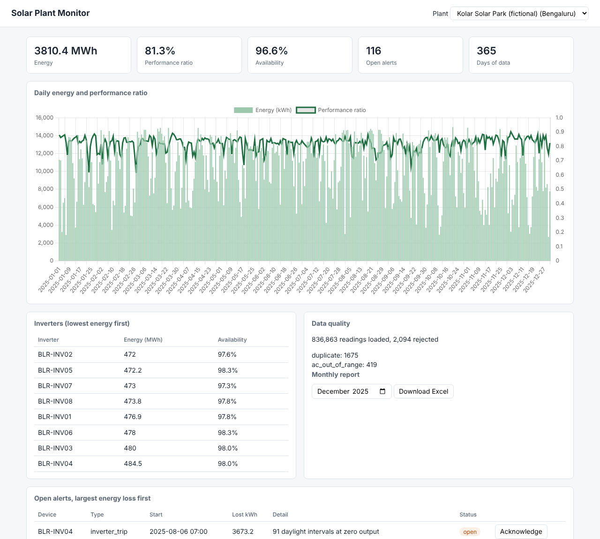

# Solar Plant Monitor

[](https://github.com/AroneBenedict/solar-plant-monitor/actions/workflows/ci.yml)

A monitoring platform for utility-scale solar plants. It takes the raw 15-minute feed from
every inverter, validates it into a SQL database, computes the KPIs asset managers report on
(energy, performance ratio, availability), detects faults, tracks them as alerts through a
workflow, and serves it all through a REST API, a web dashboard and monthly Excel reports.



## Why the data is believable

Real SCADA data is never shared publicly with labelled faults, so the feed is generated, but
from physical models and real weather rather than random numbers:

- **Real weather.** Cloud patterns come hour by hour from NREL Typical Meteorological Year
  files (bundled with [pvlib](https://pvlib-python.readthedocs.io)), applied to the sun's
  position over each plant.
- **Physical PV models (pvlib).** Solar position (NREL SPA), irradiance split into direct and
  diffuse (Erbs) and transposed onto tilted panels, cell temperature (Faiman), DC power and
  inverter output with clipping (PVWatts). Yields land at 1,450 to 1,620 kWh per kWp per
  year, the normal range for Indian plants.
- **Things that make plants messy.** Soiling between cleanings, clouds over one block of the
  plant but not another, row shading at low sun, grid curtailment (lower output that is not a
  fault), duplicate rows and corrupted values.
- **Injected faults with ground truth.** Inverter trips, failed strings, a stuck irradiance
  sensor and communication outages.

The portfolio is three fictional plants (Bengaluru, Jodhpur, Chennai): 24 inverters, 7.6 MW,
about 840,000 readings a year.

## Results

Three held-out simulated years (2.5 million readings). Thresholds were tuned on a separate
year. Full report: [`results/REPORT.md`](results/REPORT.md).

| Fault | Events | Precision | Recall | Median time to alert |
|---|---|---|---|---|
| Inverter trip | 525 | 100% | 100% | 1.1 h |
| String failure (10 to 30% loss) | 203 | 93.5% | 100% | 21 h (daily check) |
| Irradiance sensor stuck | 61 | 100% | 100% | 3.9 h |
| Communication loss | 349 | 100% | 99.4% | 0.75 h |

**Peer comparison vs. the usual check.** The common rule flags an inverter producing under
80% of what the irradiance sensor predicts. It raised **3,034** production alerts at 73.8%
precision. Comparing each inverter with its peers in the same plant raised **733** alerts at
**98.6%** precision and 100% recall: four times fewer alerts for an operator to work through,
and none of the false alarms caused by a faulty sensor, curtailment or passing clouds.

Also measured: energy lost to faults is estimated from the alerts within 13.6% of the true
loss (an underestimate), and 6,272 bad rows were rejected, each with its reason recorded.

## What it does

| Area | Where | Details |
|---|---|---|
| Ingestion and validation | `db.py` | Rules for unknown devices, missing values, out-of-range power, irradiance and temperature, and duplicates. Every rejected row is stored with its reason; re-sent rows are ignored. |
| SQL reporting | `sql/views.sql` | Daily and monthly views: energy, specific yield, performance ratio (IEC 61724 style), availability. PR is blanked on days the irradiance sensor cannot be trusted. |
| Fault detection | `detect.py` | Peer comparison for trips and failed strings, frozen-value check for the sensor, gap check for communications; lost-energy estimate per alert. |
| Alerts | `api.py` | Open, acknowledged, resolved. Invalid transitions are refused, and resolving needs a note. |
| REST API | `api.py` | Plants, daily and monthly KPIs, inverter ranking, alerts (filter, update), data quality, Excel report download. |
| Dashboard | `static/` | HTML, CSS and JavaScript with Chart.js: KPI cards, daily energy and PR chart, worst inverters, data quality, alerts with an Acknowledge button. |
| Excel report | `report.py` | Monthly workbook: summary with chart, alerts, daily KPIs, data quality. |
| Evaluation | `evaluate.py` | Detection scored against ground truth, with the sensor-based baseline for comparison. |

## A bug worth mentioning

The dashboard loads five API calls at once. Under that load the API returned intermittent
500 errors: "bad parameter or other API misuse". FastAPI runs ordinary endpoints in a thread
pool, and all of them were sharing one SQLite connection, which is not safe across threads.
Every database call now goes through a small wrapper that holds a lock until the result is
fully read, and a regression test fires 40 parallel requests. With the lock removed, that test
fails every time.

## Quickstart

```bash
pip install -e ".[dev]"
pytest --cov                                              # 24 tests
python -m solarmon.pipeline --db solar.db --seed 11       # one simulated year, about 20 s
SOLARMON_DB=solar.db uvicorn solarmon.api:app --port 8000 # open http://localhost:8000
python -m solarmon.evaluate                               # held-out evaluation, about 1 min
```

Or with Docker: `docker build -t solar-plant-monitor . && docker run -p 8000:8000 solar-plant-monitor`.

```bash
curl localhost:8000/api/plants
curl "localhost:8000/api/plants/JDH/daily?start=2025-06-01&end=2025-06-07"
curl "localhost:8000/api/alerts?status=open&plant=BLR&limit=5"
curl -X PATCH localhost:8000/api/alerts/12 -H 'content-type: application/json' \
     -d '{"status": "resolved", "note": "Inverter reset on site"}'
curl -o june.xlsx "localhost:8000/api/reports/monthly?month=2025-06"
```

## Limitations

- **Simulated plants.** The physics and weather are real, the plants and faults are not.
  Simulated faults are cleaner than real ones, which is why recall is near 100%. On a real
  plant, expect lower numbers and some fault types the simulator does not model, such as
  slow degradation, inverter derating and tracker failures.
- **The weather files are US typical years.** The cloud pattern comes from US weather stations
  (Greensboro and Miami), applied to Indian sun positions, so there is no monsoon season.
- **Peer comparison needs peers.** A fault on every inverter at once, or a plant with one
  inverter, needs the sensor-based check instead.
- **Lost energy is underestimated by about 14%,** mostly at the start and end of events.
- **SQLite and one process.** Fine for a few plants. A real deployment would use PostgreSQL
  and a scheduled ingestion job.

## Layout

```
src/solarmon/   simulator, validation and storage, detection, API, report, evaluation
src/solarmon/sql/      reporting views
src/solarmon/static/   dashboard (HTML, CSS, JS, Chart.js)
tests/          24 tests
results/        metrics.json and REPORT.md
docs/           design notes and screenshot
```

Built AI-first, with Claude as a coding assistant.
